
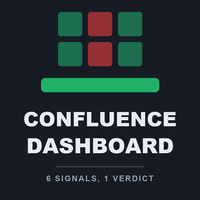

# Confluence Dashboard (MetaTrader 5 and MetaTrader 4)

A dashboard indicator with **one row per symbol** that shows six checks (EMA, ADX, MACD, RSI, SuperTrend, UT Bot) and a
**BUY, SELL or WAIT** verdict, with alerts. You choose how many checks must agree before the verdict turns BUY or SELL, so
you see at a glance which symbols line up on one timeframe.

> **This is a showcase repository: documentation and images only. There is no source code here.** The product is sold on
> the MQL5 Market. It places no orders and does not repaint.

**Website:** [allanninal.dev/mql5 (indicators)](https://www.allanninal.dev/mql5/#indicators) · [MT4 editions](https://www.allanninal.dev/mql5/#mt4) · [allanninal.dev](https://www.allanninal.dev)
· **Contact:** message me on [LinkedIn](https://www.linkedin.com/in/allanninal/).

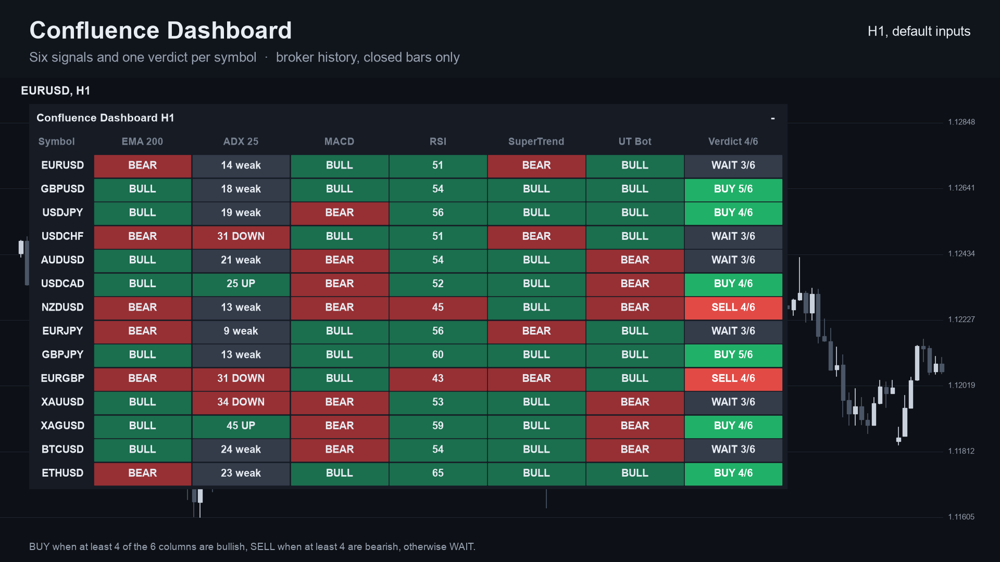

## Get it on the MQL5 Market

| Product | Platform | Price | Link |
|---|---|---|---|
| **Confluence Dashboard** | MT5 | paid | <https://www.mql5.com/en/market/product/201895> |
| **Confluence Dashboard MT4** | MT4 | paid | <https://www.mql5.com/en/market/product/202396> |

This product has no free sibling and is standalone: everything is built in. Details, current price and the Strategy Tester
demo are on the Market pages.

## What it does

- **One row per symbol, one column per check.** The symbols are your Market Watch (up to 30 by default) or your own list.
- **Six checks, each of which can be switched off:** EMA trend, ADX, MACD, RSI, SuperTrend and UT Bot.
- **A last column with the verdict and the count**, for example `BUY 5/6`.
- **You set the strictness:** how many columns must agree (4 by default). An optional rule also asks for a strong ADX.
- **A tooltip** on each cell with the numbers behind it, and **click a row** to open that symbol.
- **Alerts:** a pop-up (on by default), sound, push notification and e-mail, each switched separately, when a symbol's
  verdict changes to BUY or SELL on a closed bar. Never twice for the same symbol and bar.
- **Closed bars only.** A verdict is fixed once its bar has closed. One copy shows one timeframe (H1 by default).

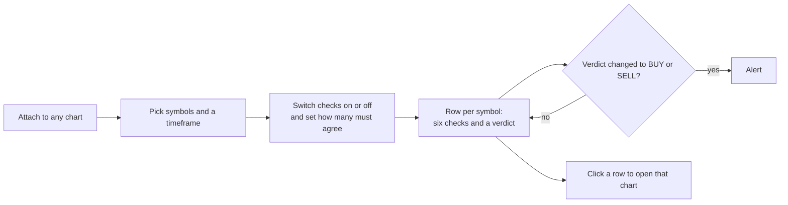

### What a verdict can be

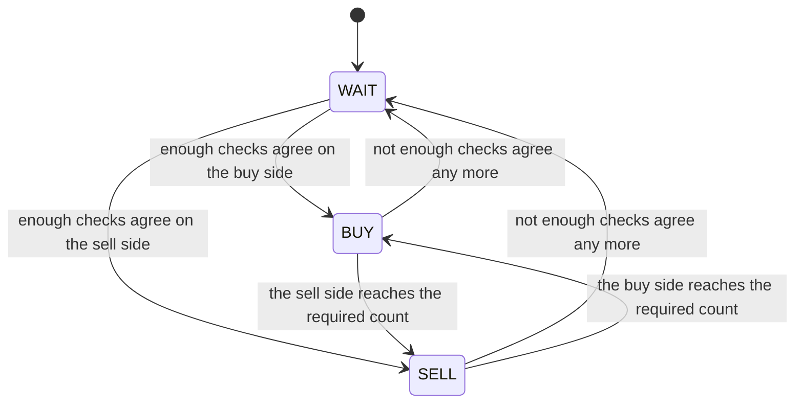

| | |
|---|---|
| 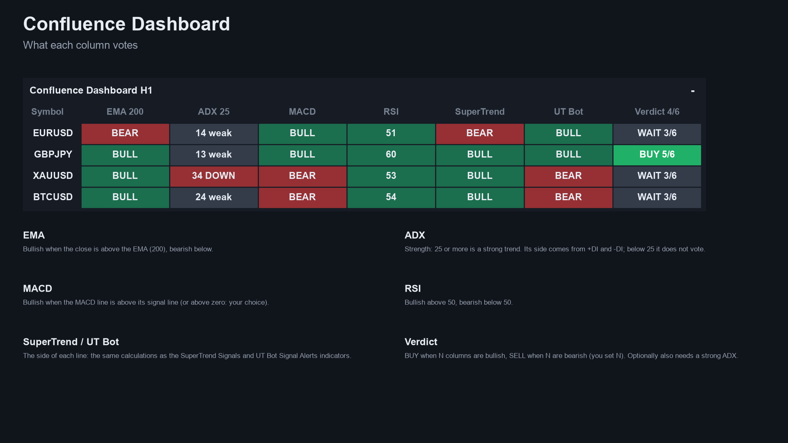 | 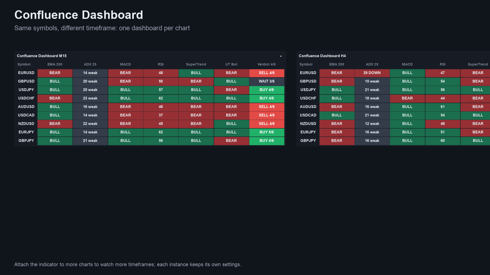 |
| 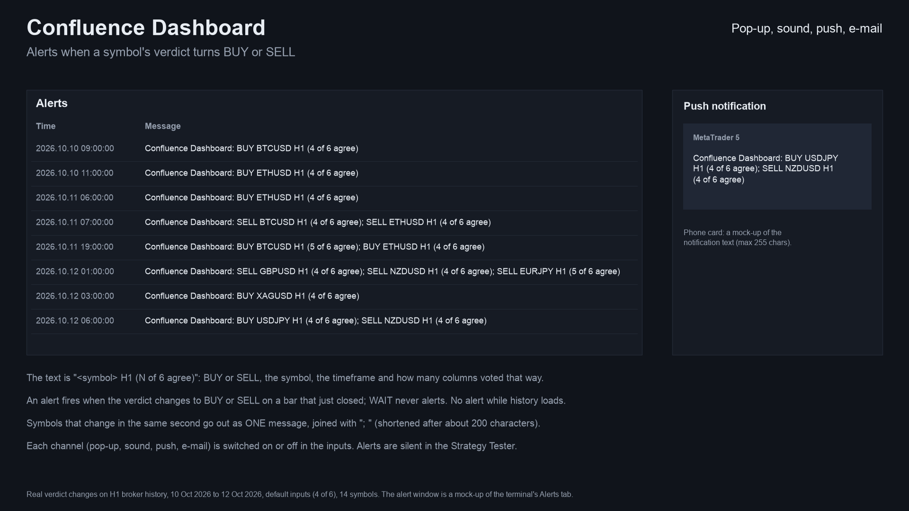 | 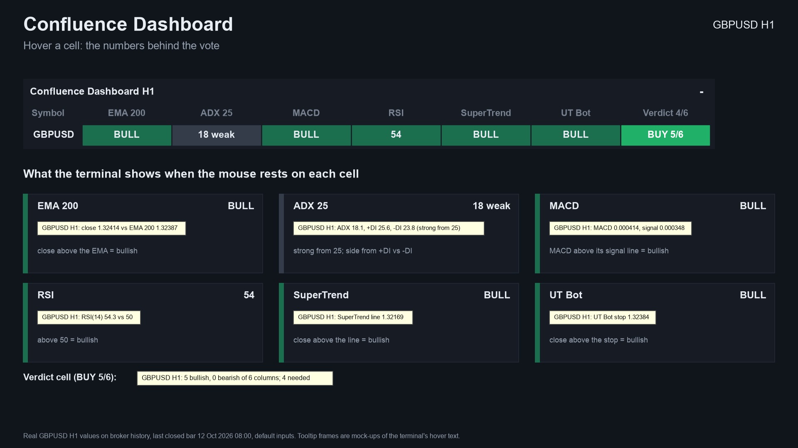 |

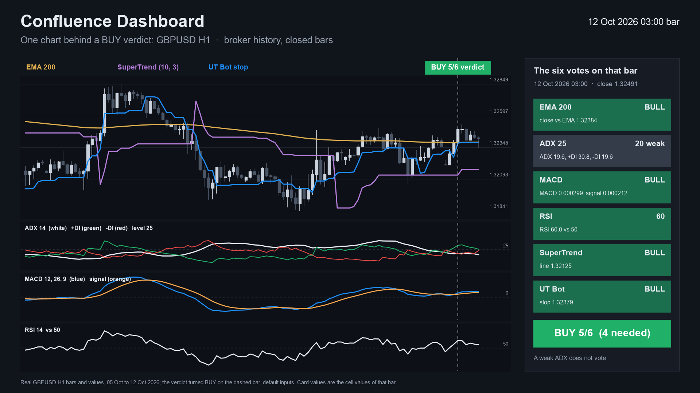

MT4 edition screenshot: [dashboard on a chart](images/mt4/01-dashboard-on-chart.png). Some screenshots are illustrations
built from broker history, not terminal captures.

## Who it is for

Traders who want to see several indicators agree across many symbols. It shows the state of technical rules; it does not
trade.

## Why it was built

- Multi-indicator "confluence" and trend systems are a recurring theme in the top lists of the MQL5 Market in our October
  2026 market research.
- It is a convenience product: the six checks are classic, widely known rules, and the value is seeing them side by side
  for a whole watchlist with a strictness you control. The research did not find a named-method demand to point to, so no
  claim of mass demand is made; it also overlaps in idea with other single-rule indicators of ours.
- Design rule: trust. Rows use closed bars only, so a verdict does not change after its bar has closed.

## Starting settings

Presets by timeframe, from the listing. They change how often the verdict flips, not profit, and none is optimised. Changes
to BUY or SELL per month on EURUSD, GBPUSD, USDJPY and XAUUSD, October 2023 to October 2026, closed bars (a code
calculation, not a trading result).

| Timeframe | Columns that agree | ADX level | Changes per month |
|---|---|---|---|
| M15 | 6 of 6 | 25 | about 54 to 56 |
| H1 | 4 of 6 (default) | 25 | about 40 to 44 |
| H4 | 4 of 6 | 20 | about 10 to 11 |
| D1 | 3 of 6 | 20 | about 2 |

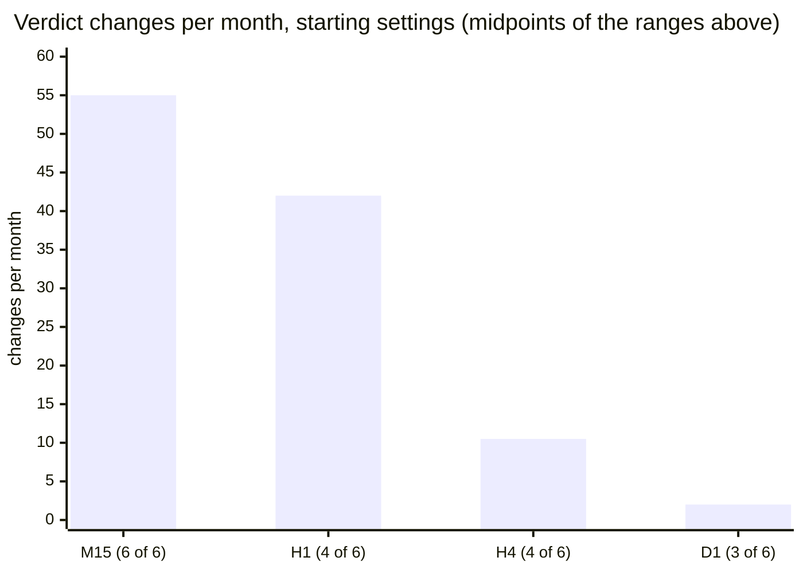

Requiring more columns to agree gives fewer changes.

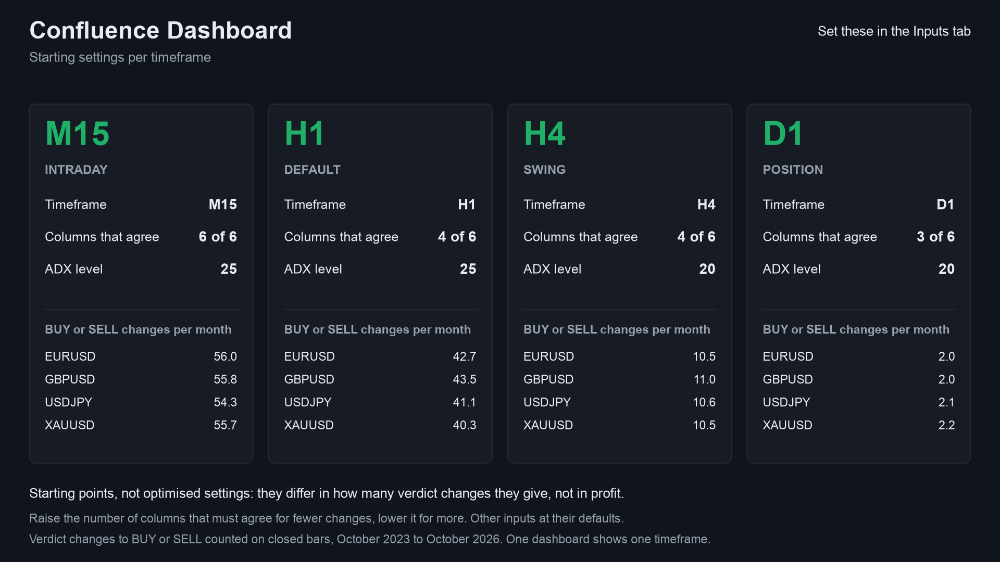

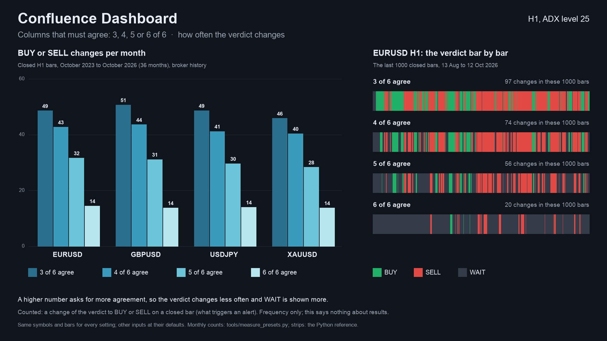

## How it was checked (results)

Every cell and verdict was compared bar by bar with an independent Python calculation, on several symbols and timeframes,
in the MetaTrader Strategy Tester.

| Check | MT5 edition | MT4 edition |
|---|---|---|
| Test files compared | 64, all pass | 156, all pass |
| Values compared | 1,795,744, 0 differences | 24,177,956, 0 differences |
| Dashboard counts vs the test's own cells, every tick | not run | 8,991,510 ticks (x 4 timeframes), 0 mismatches |
| Rows using the forming bar | none | none; live runs used closed bars only |

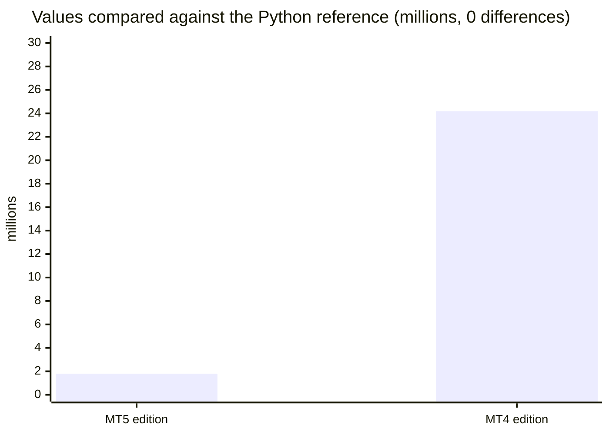

These are code checks, not trading results. The frequency table comes from the same calculation on broker history.

## Honest limits

- A dashboard shows the state of technical rules. It does not predict the market, and past signals are no indication of
  future results. No profit or accuracy claim is made. Agreement between indicators is not a promise of a move.
- The checks are classic rules that often agree because they all follow the same price; six agreeing checks are not six
  independent confirmations.
- It places no orders and manages no risk. It needs the terminal running to alert, and push needs your MetaQuotes ID set
  up in the terminal.
- The source is not published; this repository documents what the product does and the results of its checks.

---

**Website:** [allanninal.dev/mql5](https://www.allanninal.dev/mql5/#indicators) · [MT4](https://www.allanninal.dev/mql5/#mt4) · [allanninal.dev](https://www.allanninal.dev)
· Questions: message me on [LinkedIn](https://www.linkedin.com/in/allanninal/). All rights reserved, see [LICENSE](LICENSE).
